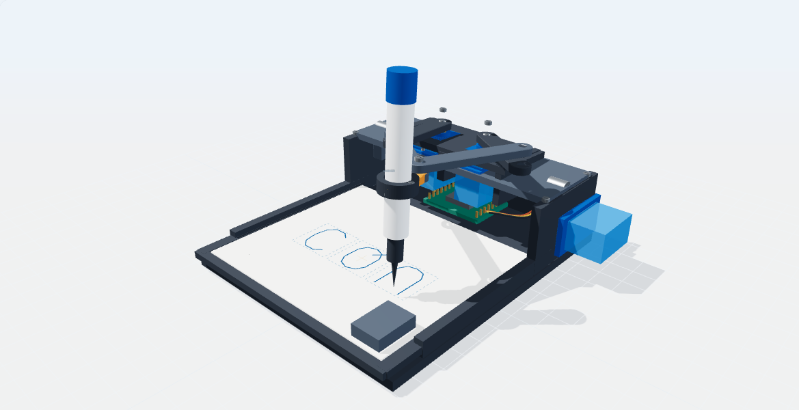

# 重庆大学明月科创实验班写字机器人

ESP32 + MicroPython 三舵机五连杆课程项目：两路控制平面笔尖位置，一路控制整个机构抬笔。仓库集中保存可离线运行的3D演示、控制程序、原始建模和答辩材料。

> **状态**：HTML与离线几何检查可复现；实机标定、字形精度与整组CQU书写仍需验证。原CAD装配缺件情况已单独说明。

## 先运行演示

下载或克隆仓库后，用 Chrome / Edge 打开 [web_demo/writing_robot_demo.html](web_demo/writing_robot_demo.html)。无需安装Python、Node或联网。

- 原CAD：旋转、缩放、分步装配、爆炸展开，44个缓存零件实例。
- 运动演示：数字8、汉字中/王、CQU逐笔书写；第三路演示整体抬笔。
- 每字20×20mm占地框，字间距2mm，整组居中；笔迹按字形比例摆放。

## 目录

| 目录 | 内容与用途 |
| --- | --- |
| [web_demo/](web_demo/) | 自包含HTML、模板、几何模块、Three.js依赖、CAD网格与预览 |
| [firmware/](firmware/) | ESP32控制、上电入口、角度/两点标定/纯计算预检 |
| [models/](models/) | 原始25个零件和1个装配体，及缺件说明 |
| [presentation/](presentation/) | LibreOffice修复版PPT、PDF备用、讲稿及SVG页面源 |
| [docs/](docs/) | 机构原理、参数差异和离线验证记录 |
| [tests/](tests/) | 不创建PWM的离线控制检查与几何验证 |

## 改网页与离线检查

```sh
python3 web_demo/build_demo.py
python3 -m unittest discover -s tests -p 'test_*.py' -v
node tests/check_web_geometry.js
```

重建HTML仅需Python标准库；Node只用于可选离线几何检查。

## 使用开发板代码

见 [firmware/README.md](firmware/README.md)。发布副本默认关闭自动书写与标定放行：AUTOSTART=False、CALIBRATED=False。引脚、板中心、左右方向与增益、抬落笔角度必须按实机确认。

先做纯计算check，再完成两点标定和无笔空走；不能把配置里的5/175°电气门限当作几何工作区，更不能把演示效果当实机已经成功。

## 材料边界

- CAD核实偏置幅值45°；网页取+45°观察侧，用户固件仍保留60°，需实物确认后统一。
- 原总装只有1根主动臂、腕孔未闭合，且缺11个源依赖；未宣称已修复原生配合。
- 清空网页笔迹是页面功能，实机自动擦除尚未实现。
- PPT有14页主讲+2页附录和演讲者备注；PDF为备用。AI用于代码整理、复核与演示辅助，成员仍需理解代码与测量依据。

## 第三方组件

网页内嵌 Three.js r128 与 OrbitControls，MIT许可证原文见 [web_demo/vendor/THREE_LICENSE.txt](web_demo/vendor/THREE_LICENSE.txt)。原模型与课程材料按用户提供内容保存，本次不为它们重新指定开源许可。


